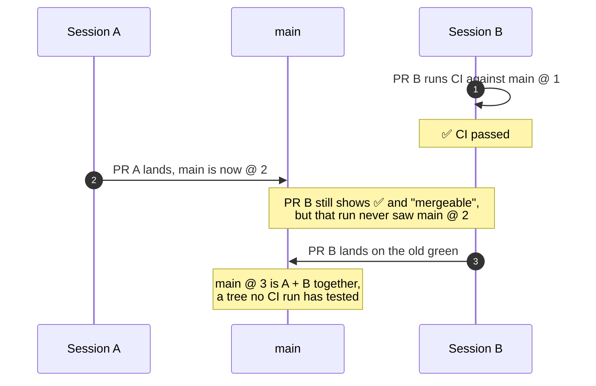
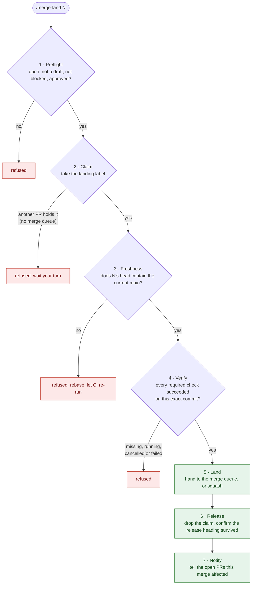

# merge-coordinator

[](https://github.com/archos-media/merge-coordinator/actions/workflows/test.yml)


**Several Claude Code sessions, one main branch.** merge-coordinator makes sure
no pull request lands on a green check that never saw the `main` it is merging
into, works out which pull requests may land in parallel, and tells the
pull requests a landing has broken, with the reason.

[The problem](#the-problem) · [What it does](#what-it-does) · [Numbers](#in-numbers) ·
[Who it is for](#who-it-is-for) · [Compared with](#how-it-compares) ·
[Install](#install) · [FAQ](#faq)

---

## The problem

When one pull request lands, every other open pull request's green check stops
meaning what it says. The run that passed tested a `main` that no longer exists.
GitHub can force a re-test ("require branches to be up to date before
merging"), but then every pull request has to update and run its whole CI again
before it may merge, each time anything else lands. Without that setting,
GitHub keeps calling the stale pull request **mergeable**.

One person landing one pull request at a time rarely hits this. Four agents
landing in parallel hit it all day.



Four ways it went wrong while everything looked fine, on the repository this
was built for:

| What you see | What was actually true |
|---|---|
| A green check and "mergeable" | An open pull request was **49 commits behind** `main`. Its green came from a run against a `main` that had since moved 49 times. |
| A clean merge and green CI | A pull request opened before a release edited the same `CHANGELOG.md` block the release did. Git merged it without a conflict, and **the release's heading vanished** from `main`. No merge queue catches this: there is no conflict to find. |
| An old green on a conflicting pull request | A pull request that conflicts with its base **runs no CI at all**, so its last green result stays on the page as if it still meant something. |
| Two sessions, both busy | Both were editing the **same files for hours**, with no way to see each other until one landed. It happened twice in one day while this tool was being built. |

## What it does

It works in three layers. The middle one is the plugin; the outer two are
GitHub features it drives.

| Layer | Question it answers | How |
|---|---|---|
| **Register** | Who is touching what, right now? | A draft pull request opened when work starts, listing the paths it expects to touch |
| **Order** | Who lands next? What may land in parallel? | Compares every open pull request's changed and declared files, plus your *hotspots*: files such as a changelog, where two pull requests that merge cleanly can still break each other |
| **Land** | Is this exact commit safe to merge? | GitHub's merge queue where you have one. Where you don't, a *claim*: a label that lets one pull request land at a time, plus a check that its head contains the current `main` and its required checks passed on that exact commit |

### Five commands

| Command | What it does |
|---|---|
| `/merge-register` | Opens a draft pull request listing the paths this branch expects to touch, so other sessions can see it before any code exists. Entering a worktree opens the draft by itself; run the command once you know the paths. |
| `/merge-ready N` | Takes N out of draft, but only once no other ready pull request touches the same files. Marking ready is when CI starts, so that is when it checks. |
| `/merge-status` | Everything in flight: which pull requests are fresh, whose checks really passed, who holds the claim, which Dependabot pull requests are waiting, and what to land next. |
| `/merge-land N` | The landing sequence below. Safe to re-run from any point. |
| `/merge-deps N` | Reviews Dependabot pull request N: what moves, its release notes, its checks. Records safe, unsafe or needs a fix-up, then lands it, closes it, or brings you the options. |

### Dependabot pull requests are not left in the way

While a Dependabot pull request is waiting, `/merge-ready` and `/merge-land`
stop other work and the session asks you: land it first, or later? Yes runs
`/merge-deps`. Later is `--skip-deps`, and it lasts one command. `--force` and
`--admin` do not get past the stop. Without it, sessions stepped past these pull
requests until Dependabot closed them unlanded a week later.

### The landing sequence



**With a merge queue, three steps change.**
- Step 2 lets several pull requests in at once, because the queue tests them
  together.
- Step 3 checks for a *conflict* instead of staleness. The queue retests against
  the real `main` anyway, so forcing a rebase first would only buy a second full
  CI run.
- Steps 6 and 7 run once the queue has merged, with `land.sh N --post-merge`.

**Who gets told in step 7 depends on whether you have a queue.**
- **Without a queue:** every open pull request that shares a file or a hotspot
  with the merge is told. Nothing will retest it, so its green is now
  worthless.
- **With a queue:** only the pull requests the queue *cannot* fix are told. One
  that now conflicts is labelled `merge:needs-rebase` with a comment naming the
  merge. One sharing a hotspot gets a heads-up comment. One that is stale but
  still merges cleanly hears nothing, because the queue will retest it anyway.

Either way, the session finds out when the merge happens, not an hour later
from a red run with no reason attached.

### Hooks that keep sessions on the path

| When | What the hook does |
|---|---|
| Before `gh pr merge` | Refuses a bare merge and points to `/merge-land`. Every step above is one a bare merge skips. |
| Before `gh pr create` | Refuses a pull request that is not a draft. A draft registers the branch, and runs no CI once drafts are set to skip it. |
| Before `gh pr ready` | Refuses a bare ready and points to `/merge-ready`, which checks for overlapping work first. Also refuses while a Dependabot pull request is waiting. |
| Before entering a worktree | Refuses a worktree named for an issue that another open pull request has already claimed (see [issue claims](#faq)). |
| After entering a worktree | Registers the branch as a draft pull request, so it is visible at once, and tells the session which Dependabot pull requests are open. |
| Session start, and after entering a worktree | Says if a repository's pinned copy of the plugin is behind the latest release. A session in a folder that is not a repository hears the same about each repository one folder below it that carries a copy. |
| Before editing a pinned copy | Refuses edits to a copy of the plugin pinned inside another repository ([why copies exist](#releases-and-copies-in-other-repositories)). |

The hooks judge the repository a command **acts on**, not the folder it
starts in. They read `-R OWNER/NAME`, a pull request URL, `GH_REPO`, the REST
merge path, and one leading `cd <path> &&`. A merge or ready command that
points elsewhere in any other way (a second `cd`, a variable, `sudo` or
`xargs` in front of `gh`, a string handed to `bash -c`) is refused, because it
might be aimed at a repository that has opted in. The refusal lists the forms
the hooks read.

It is **inert until a repository opts in**, with that one exception. Without a
`.github/merge-coordinator.json` the hooks step aside and the landing scripts
refuse to run, so installing it at user scope is safe. Drafts and `gh pr ready
--undo` are never refused. For a real emergency, prefixing a command with
`MERGE_COORDINATOR_OVERRIDE=1` steps over the merge and ready hooks.

## In numbers

Measured on the repository it was built for: a private monorepo where several
Claude Code sessions land in parallel. *Before* is the 15 days before it went
live, with no coordination and no merge queue. *After* is four weeks starting
two weeks later, with GitHub's merge queue and merge-coordinator in place.
Every figure is per landed pull request or a rate, because the two windows
differ in length and traffic. They come from GitHub's own records: pull request
timelines and every Actions run in both windows.

### CI per landed pull request: 11 minutes down to 6

Before, nearly every pull request ran the full test suite at least twice before
it landed: once on the pull request, and again on `main` after the merge,
usually testing the same code a second time. More than a third ran it three or
more times. Now almost three in four land after a single run.

| | Before<br/><sub>10–24 Aug</sub> | After<br/><sub>8 Sep – 5 Oct</sub> |
|---|--:|--:|
| **CI time per landed pull request** | 11.0 min | **6.3 min** <sub>(−43%)</sub> |
| **Full test-suite runs per landed pull request**¹ | 2.4 | **1.3** |
| Landed after the suite ran twice or more¹ | 89% | 27% |
| Landed after the suite ran three times or more¹ | 36% | **2%** |
| Full CI runs on `main` after each merge | 0.65 per merge | **none** |

**How many times the full suite ran before a pull request landed**¹

| Runs | Before | After |
|:-:|---|---|
| 1 | `██░░░░░░░░░░░░░░░░░░` 11% | `███████████████░░░░░` **73%** |
| 2 | `███████████░░░░░░░░░` 53% | `█████░░░░░░░░░░░░░░░` 24% |
| 3 | `█████░░░░░░░░░░░░░░░` 24% | `░░░░░░░░░░░░░░░░░░░░` 2% |
| 4 or more | `██░░░░░░░░░░░░░░░░░░` 12% | `░░░░░░░░░░░░░░░░░░░░` under 1% |

<sub>¹ Counted over pull requests that ran the full suite at all. Before, 69 of
241 landed after only a short CI pass that skipped the suite; they are left out
here. CI time per landed pull request includes them.</sub>

**Where the repeat runs went:**

- **The run on `main` after every merge is gone.** The merge queue has already
  tested the exact tree the merge produces, so testing it again on `main` learned
  nothing. The adoption guide shows how to drop it safely.
- **The merge queue's own run is usually a 20-second check, not a rebuild.** In
  78% of merges the queue was about to test a tree the pull request's run had
  already tested, and a step in the repository's own CI recognised that and
  skipped the rebuild. `/merge-ready` is what keeps that case common: work that
  overlaps waits as a draft, so the tree doesn't change under a pull request
  that is already testing.
- **Drafts run no CI.** With drafts set to skip CI (adoption guide, section 5),
  a registered draft runs nothing until it is marked ready, so a branch is
  visible to other sessions from its first minute without adding a single run.

### Safety: nothing lands on a stale green

| | Before | After |
|---|--:|--:|
| **Merged while behind `main`, with nothing retesting the combined code** | **37%**<br/><sub>88 of 241; median 3 commits behind, worst 238</sub> | **0%**<br/><sub>0 of 263</sub> |
| Merged through the merge queue | 0% | 262 of 263 |

Most of this table is the merge queue's work: 47 pull requests were still
behind `main` when they merged in the *after* window, and the queue retested
each one against the real `main` first.

For anyone without bypass rights, GitHub itself refuses a merge that goes
around a required merge queue, and a plain `gh pr merge` joins the queue.
Unless the rule says otherwise, an admin can still go around it, with
`gh pr merge --admin` or from the web page. The sessions on that repository
ran with admin rights. The hook refused their bare `gh pr merge`, `--admin`
included, and pointed them to `/merge-land`, which runs the steps a queue does
not. 262 of 263 merges went through the queue.

## Who it is for

**It earns its keep if:**

- Several Claude Code sessions (or several people) land pull requests into
  **one branch at the same time**.
- Each change runs the full test suite **two or three times** before it lands,
  and you want it to be once.
- You want stale merges stopped **without** "require branches to be up to
  date", which sends every pull request back through CI each time anything
  lands. That takes a merge queue. Without one, landing asks for a rebase much
  as that setting does, and saves only the runs that drafts skip.
- You have files that everybody appends to: a changelog, a migrations folder, a
  registry, generated code. Those are the places where a *clean* merge is the
  dangerous one.
- You want an agent to be told *why* its pull request needs work, not to find
  out from a red run later.

**You probably don't need it if:**

- One person or one session lands one pull request at a time. Nothing goes
  stale underneath you.
- Branch protection already requires up-to-date branches and your traffic is
  low enough that the extra CI runs don't hurt.
- A merge queue alone is enough for you. If you have no hotspots and nobody
  needs telling, the queue does the most important part by itself.
- Your repository isn't on GitHub. Everything here reads GitHub's API.
- Nobody uses Claude Code. The scripts run without it, but the commands, and the
  hooks that keep sessions on the path, are Claude Code features.

## How it compares

What each setup does on its own:

| | GitHub defaults | "Require branches to be up to date" | GitHub merge queue | merge-coordinator + merge queue |
|---|:-:|:-:|:-:|:-:|
| A stale green check can't land untested | ✗ | ✓ | ✓ | ✓ |
| A merge around the gate is refused | ✗ | ◐¹ | ✓² | ✓² |
| An agent's merge that skips the steps below is stopped | ✗ | ✗ | ✗ | ✓³ |
| Two pull requests on the same hotspot are kept apart | ✗ | ✗ | ✗⁴ | ✓ |
| The newest release heading is checked after landing | ✗ | ✗ | ✗ | ✓ |
| A pull request a landing broke is told, with the reason | ✗ | ✗ | ◐⁵ | ✓ |
| Sessions see each other before code exists | ✗ | ✗ | ✗ | ✓ |
| Overlapping work waits as a draft instead of running CI twice | ✗ | ✗ | ✗ | ✓ |
| Must re-run CI after each landing | nothing | every open pull request, before it may merge | only what the queue merges | only what the queue merges |

<sub>¹ It refuses a stale merge for anyone without bypass rights. Admins can
bypass it unless the rule says otherwise.<br/>
² GitHub's queue is switched on by a "Require merge queue" rule, and a merge
around it needs bypass rights. With "Do not allow bypassing", admins are held
too. `gh pr merge` on such a branch joins the queue.<br/>
³ Inside Claude Code only. The hooks refuse a bare `gh pr merge`, which would
skip the hotspot order, the release-heading check and telling the others,
even for a session with admin rights. They run on your machine, and
`MERGE_COORDINATOR_OVERRIDE=1` steps over them: a person in GitHub's web page,
another agent or a script is held only by GitHub's own rules.<br/>
⁴ Some hosted merge queues order or co-test pull requests that touch the same
paths. None we found holds two out of CI because a clean merge of that file is
the dangerous case.<br/>
⁵ A merge queue tells a pull request it removes from the queue, and why. It
does not tell open pull requests outside the queue, or a hotspot neighbour
where nothing conflicts.</sub>

**It works before and after a merge queue, not instead of one.**

- **Before the queue:** it decides which pull requests may start CI, so
  overlapping work doesn't race.
- **After the queue:** it checks what each landing did, and tells the pull
  requests it affected.
- **The queue itself:** GitHub's own. You get it on public repositories owned
  by an organisation, and on private ones with GitHub Enterprise Cloud.
- **No queue?** It lands one pull request at a time instead. That works on any
  plan, but saves less CI (see the FAQ).
- **Other merge queues:** hosted ones replace GitHub's queue, so
  merge-coordinator can't work with them yet. They are paid services, at around
  $20 to $50 per developer a month (October 2026). merge-coordinator is free
  and open source.

## Install

**Needs:** Claude Code, an authenticated [`gh`](https://cli.github.com/), git,
bash and Python 3. On Windows, Git Bash.

```sh
claude plugin install merge-coordinator --marketplace archos-media/merge-coordinator
```

That needs Claude Code 2.1.292 or later. On an older one, add the marketplace
first:

```sh
claude plugin marketplace add archos-media/merge-coordinator
claude plugin install merge-coordinator@merge-coordinator --scope user
```

Then, in each repository that should use it:

1. **Add the config.** Copy the plugin's `config.example.json` to
   `.github/merge-coordinator.json`. Set the required check names exactly as
   branch protection spells them, choose a backbone, and list your hotspots,
   with the reason for each.
2. **Create three labels:** `merge:landing`, `merge:blocked`,
   `merge:needs-rebase`.
3. **Check it against your real repository.** Copy `probe.example.json` to
   `.github/merge-coordinator-probe.json`, point it at your own history, and ask
   Claude to run the plugin's `scripts/probe-live.sh` from inside the
   repository. It is read-only and checks every API read the plugin makes.

The [adoption guide](skills/merge-coordinator/references/adopting.md) covers
each step, running without a merge queue, turning off CI on drafts without
creating a green that tested nothing, and what CI needs for a queue to work.

Updates don't arrive by themselves: Claude Code leaves auto-update off for a
marketplace like this one. Turn it on in `/plugin`, under **Marketplaces**:
select `merge-coordinator`, then **Enable auto-update**. Or update by hand:
`claude plugin update merge-coordinator@merge-coordinator`. Release notes are
in the [changelog](CHANGELOG.md).

## FAQ

<details>
<summary><b>Does it do anything in a repository that hasn't opted in?</b></summary>

Almost nothing. Without `.github/merge-coordinator.json` at the repository
root, the hooks step aside and the landing scripts refuse to run. The one
exception is a merge or ready command written in a form the hooks cannot
trace to a repository, such as `sudo gh pr merge 7` or `gh pr merge "$PR"`. It
is refused everywhere, because it might be aimed at a repository that has
opted in. Rewrite it with `-R OWNER/NAME`, or prefix it with
`MERGE_COORDINATOR_OVERRIDE=1`. Installing it at user scope is safe on every
project.
</details>

<details>
<summary><b>What does it run, send and fetch?</b></summary>

Bash and Python scripts, all readable in `scripts/`. Every network call is
`gh` or `git`, run as you, to GitHub: to the repositories you point it at, and
to this repository when it checks for a newer release or makes a pinned copy.
It reads no token itself and sends nothing anywhere else. What it writes on
GitHub is pull request state: drafts, labels, comments, ready, and merges
through the landing sequence.
</details>

<details>
<summary><b>Do I need GitHub's merge queue?</b></summary>

No. Set `backbone: serialized-claim` and the claim, plus the freshness and
verify steps, carry the guarantee. That guarantee is narrower: a merge that is
fine on its own but breaks in combination with the one before it shows up as a
red build on `main` afterwards, not as a refused merge. A queue catches that
case. See section 4 of the adoption guide.

GitHub offers its merge queue on public repositories owned by an
organisation, and on private ones only under GitHub Enterprise Cloud. On a
private repository on another plan, the claim is the path you have.
</details>

<details>
<summary><b>What is a hotspot?</b></summary>

A path where a *clean* textual merge is the dangerous case: a changelog everyone
appends to, a migrations folder numbered at merge time, generated or vendored
code. Two pull requests touching the same hotspot are kept from running CI at
the same time even when their diffs don't share a line, and a landing tells the
other one. Each hotspot in the config carries a `why`, so the rule can be argued
with later instead of just deleted.
</details>

<details>
<summary><b>What are issue claims?</b></summary>

A pull request claims an issue with an `issue: N` line in its registration, or
with GitHub's own `Closes #N`. When two open pull requests claim the same issue,
the older one holds it. A hook refuses a new worktree for an issue that is
already claimed, so the work isn't done twice. A repository can also add a CI
check that fails the duplicate: copy `issue-claim.example.yml` and
`issue-claim-others.example.yml` to `.github/workflows/issue-claim.yml` and
`issue-claim-others.yml`. The [protocol](skills/merge-coordinator/references/protocol.md)
describes them. It is optional.
</details>

<details>
<summary><b>What if I really have to merge right now?</b></summary>

Prefix the command with `MERGE_COORDINATOR_OVERRIDE=1`. A control that can't be
stepped over in an emergency gets deleted rather than respected. Say why in the
pull request. An override merge skips the landing sequence entirely, so if your
config lists workflows to run after a merge outside the queue, the hook prints
them for you to run.
</details>

<details>
<summary><b>Does it work for human teams?</b></summary>

The scripts do: `land.sh`, `overlap.sh` and `queue-state.sh` are bash and Python
over `gh`. The slash commands, and the hooks that stop a bare `gh pr merge`, are
Claude Code features. A repository whose GitHub Actions or non-Claude agents
need the scripts can carry a pinned copy (see below).
</details>

<details>
<summary><b>Will registration open a lot of pull requests?</b></summary>

One draft per worktree, including throwaway ones. That is cheap only if drafts
run no CI, so turn that off first. Section 5 of the adoption guide shows how,
without the aggregate job reporting a green that tested nothing.
</details>

## What is here

| Path | What it is |
|---|---|
| `skills/merge-coordinator/SKILL.md` | When and how a session coordinates |
| `skills/merge-coordinator/references/` | The [protocol](skills/merge-coordinator/references/protocol.md), step by step, and the [adoption guide](skills/merge-coordinator/references/adopting.md) |
| `commands/` | `/merge-register`, `/merge-ready`, `/merge-status`, `/merge-land`, `/merge-deps` |
| `hooks/hooks.json` | The hooks in the table above |
| `scripts/` | The mechanism. `test-*.sh` are offline suites; `probe-live.sh` checks the API reads against a real repository |
| `config.example.json` | Start of a repository's `.github/merge-coordinator.json` |
| `probe.example.json` | Start of a repository's `.github/merge-coordinator-probe.json` |
| `issue-claim.example.yml`, `issue-claim-others.example.yml` | Start of a repository's `.github/workflows/issue-claim.yml` (the issue claim check) and `issue-claim-others.yml` (re-checks every pull request a change affects, the one that changed included) |
| `CHANGELOG.md` | Every release, newest first |
| `LICENSE` | The Apache License 2.0 |
| `CONTRIBUTING.md`, `SECURITY.md`, `SUPPORT.md`, `CODE_OF_CONDUCT.md` | How to contribute, how to report a vulnerability, what support to expect, and how everyone is expected to behave |

## Releases, and copies in other repositories

Releases are tags, `vN.N.N`, matching `version` in `.claude-plugin/plugin.json`
(CI refuses a tag that doesn't). An installed plugin updates only when that
version changes, so every pull request that changes a file outside the
top-level `README.md` and `.github/` raises it. `scripts/check-version-bump.sh`
fails the pull request that doesn't. After every merge, `scripts/release-tag.sh`
fails `main`'s run if a plugin file changed since the commit that set the
current version, and otherwise tags that commit `v<version>` if it is not
tagged yet. `scripts/release-publish.sh` then publishes the tag's GitHub
Release, whose notes are the version's section of `CHANGELOG.md`; CI fails a
pull request whose version has no section.

Only Claude Code sessions see an installed plugin, so a repository whose
GitHub Actions or non-Claude agents need the
scripts carries a pinned copy made by `scripts/vendor.sh <tag>`, held to that
release by `scripts/check-vendored.sh` in its CI. Never edit a copy: change it
here, release, re-vendor with the installed plugin's `vendor.sh`, never the
copy's own. Details in section 1b of the adoption guide.

A change to the claim rule (`scripts/lib/claims.py`) reaches Claude sessions
through the installed plugin and GitHub through each repository's copy, so
release it as one tag and update both: `claude plugin update
merge-coordinator@merge-coordinator`, then `vendor.sh <tag>` in each repository.

## Tests

```sh
f=0; for t in scripts/test-*.sh; do bash "$t" || { echo "FAILED: $t"; f=1; }; done; [ "$f" -eq 0 ]
```

The suites are offline and run in CI on every pull request. `probe-live.sh` is
not a test suite: run it by hand from inside an adopting repository after any
change to a `--jq` filter. This repository lands its own pull requests with
the plugin.

## How it was made

Most of the code was written by Claude (Anthropic), working as Archotron,
under the direction of Archos Media, where a person decides what is built and
what lands. [CONTRIBUTING.md](CONTRIBUTING.md) says how, and what contributions
are welcome.

Copyright 2026 Archos Media. This repository is licensed under the
[Apache License 2.0](LICENSE), to the extent copyright subsists in it.
